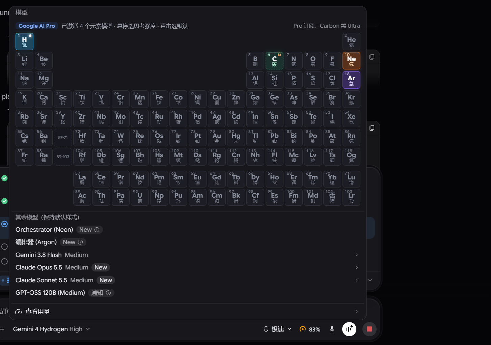
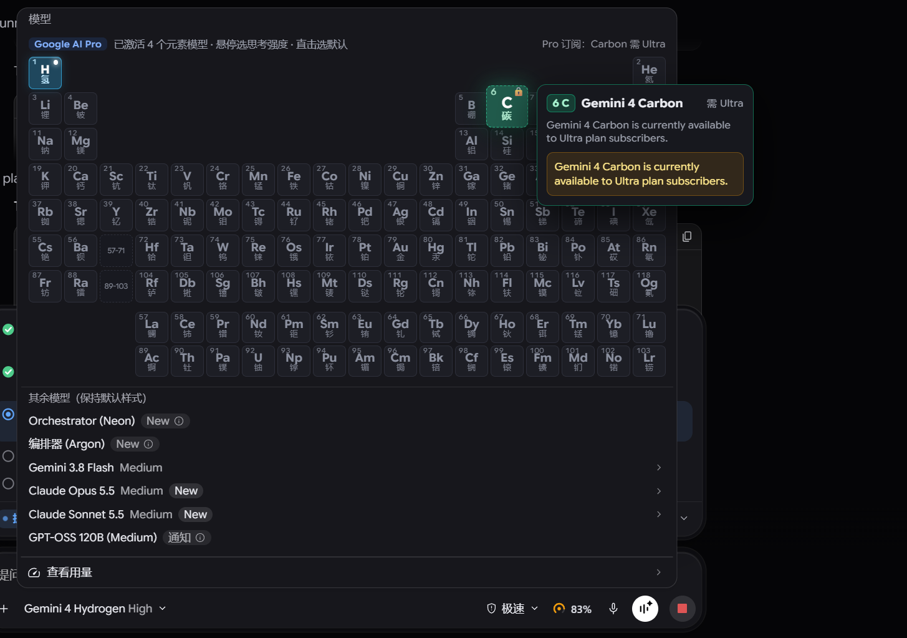

<div align="center">


<br /><br />

# Antigravity Periodic Model Selector

**An unofficial, extensible 118-element Periodic Table model selector for Antigravity — featuring solid-color hover cards, effort-level popovers, tier-aware badges, particle-morph selection animations, and built-in GitHub update checks.**

[](https://github.com/trrrrrryg/antigravity-periodic-model-selector/releases)
[](#key-features)
[](#live-demo)
[](#security-privacy--disclaimer)

**English** | [简体中文](./README.zh-CN.md)

[Live Demo](#live-demo) · [Screenshots](#screenshots) · [Key Features](#key-features) · [Quick Install](#quick-install) · [Security & Disclaimer](#security-privacy--disclaimer)

---

### Live Demo


<sub>Hover any active element (`H`, `C`, `Ne`, `Ar`, and any future element-named Gemini models) to zoom in, pick a reasoning effort level, and inspect tier availability. Click to select: the menu closes cleanly while the element card lingers mid-air, shatters into glowing particles, and reforms into the selected model label in the bottom-left trigger.</sub>

</div>

<br />

## Screenshots

<table>
  <tr>
    <td align="center" width="34%">
      <br />
      <strong>1. Periodic Table + Native Model List</strong><br />
      <sub>Dynamically lights up active element models (<code>H</code> / <code>C</code> / <code>Ne</code> / <code>Ar</code>) across the 118-element grid while keeping Orchestrator, Flash, Claude, and GPT untouched below.</sub>
    </td>
    <td align="center" width="33%">
      <br />
      <strong>2. Solid-Color Hover & Effort Popover</strong><br />
      <sub>Hovering an active element smoothly scales the tile (1.28&times;) and opens an opaque effort picker; clicking a tile directly selects its default effort level.</sub>
    </td>
    <td align="center" width="33%">
      <br />
      <strong>3. Particle Dissolve & Text Morph</strong><br />
      <sub>Upon selection, the chosen element bursts into pixel particles that fly to the bottom-left trigger and assemble into the newly selected model name.</sub>
    </td>
  </tr>
</table>

## Key Features

- **Extensible 118-Element Auto-Discovery (Zero Hardcoded Models)**: Reads live `modelSorts` and `groups` from Antigravity's model selector context on open and maps element-named models onto their IUPAC periodic table coordinates automatically. Future element models (e.g., `He`, `B`, `Si`, etc.) light up automatically, and custom aliases can be registered at runtime via `window.__AGY_PTABLE.registerAlias(alias, symbol)`.
- **Subscription Tier Awareness (Free / Pro / Ultra)**:
  - **Free**: Gemini 4 series elements are visually locked with an upgrade notice.
  - **Pro**: `H`, `Ne`, and `Ar` are available; `6 C (Carbon)` is marked locked as Ultra-only.
  - **Ultra**: Full unrestricted access across all element models.
  - The right-hand **Periodic Model Selector** auxiliary pane includes a tier preview switcher so you can inspect all three visual states without modifying your actual subscription.
- **100% Opaque Solid-Color Styling**: Inactive tiles, active element cards, and effort popovers use solid blended surfaces inside isolated Shadow DOM roots so text remains sharp with zero bleed-through.
- **Startup GitHub Update Check & Explicit One-Click Update**:
  - Automatically checks GitHub Releases on startup (with jsDelivr / GitHub Raw fallback).
  - When a newer version is available, a non-intrusive badge appears in the top-right corner of the periodic table header without blocking model selection or closing the menu.
  - Clicking the badge lets you choose **Direct Update** (downloads, verifies, replaces plugin files while preserving `sidecar_data`, and reloads the sidecar) or **Update Later** (hides the badge for the current session).

## Quick Install

1. Launch Antigravity with local remote debugging enabled:
   ```text
   --remote-debugging-port=9222
   ```
2. Download the latest `antigravity-periodic-model-selector-v1.1.0.zip` from [Releases](https://github.com/trrrrrryg/antigravity-periodic-model-selector/releases) and extract it to `~/.gemini/config/plugins/antigravity-periodic-model-selector`, **or** clone directly:
   ```bash
   git clone https://github.com/trrrrrryg/antigravity-periodic-model-selector.git ~/.gemini/config/plugins/antigravity-periodic-model-selector
   agy plugin validate ~/.gemini/config/plugins/antigravity-periodic-model-selector
   agy plugin enable antigravity-periodic-model-selector
   ```
3. Open the model selector at the bottom-left of any Antigravity chat window.

### Uninstall

```bash
agy plugin disable antigravity-periodic-model-selector
rm -rf ~/.gemini/config/plugins/antigravity-periodic-model-selector
```

## Security, Privacy & Disclaimer

> **Unofficial Community Project**  
> This repository is an independent, unofficial open-source UI experiment created by the community. It is **not** affiliated with, endorsed by, sponsored by, or officially supported by Google or the Antigravity team.

- **How It Works (Local UI Enhancement Only)**:
  - This plugin uses a local Antigravity sidecar (`sidecars/periodic_selector/main.mjs`) that connects exclusively to Electron's local Chrome DevTools Protocol endpoint on `127.0.0.1` (`--remote-debugging-port=9222`) to enhance the model selector dropdown using isolated Shadow DOM nodes.
  - It **does not** modify or patch Antigravity application binaries (`app.asar`), and removing the plugin directory completely restores the default UI.
- **Respects Official Entitlements & Quotas**:
  - This plugin is strictly a visual/interaction layer. It **never** bypasses subscription tiers, server-side authorization, rate limits, or quota controls (e.g., Pro accounts still cannot invoke Ultra-only models).
- **Zero Telemetry & Zero Dependencies**:
  - Pure JavaScript / Node.js ESM with **zero** third-party npm packages — the entire codebase is a few small, readable files you can audit in minutes.
  - No chat messages, API keys, credentials, or user telemetry are ever collected or transmitted.
- **Explicit User-Triggered Updates**:
  - The startup version check only makes a read-only `GET` request to `api.github.com` (with `cdn.jsdelivr.net` / `raw.githubusercontent.com` fallback) to compare the version string in `plugin.json`.
  - Code is **never** silently downloaded or auto-executed in the background. File replacement happens **only** after you explicitly click **Direct Update**.
- **Note on `--remote-debugging-port=9222`**:
  - Enabling Electron's local debugging flag allows local processes on your machine (`127.0.0.1`) to inspect or debug the Antigravity renderer window. Only enable it in a trusted local environment, and disable it if your security policy prohibits local DevTools debugging ports.
- **Compatibility Notice**:
  - Because CDP DOM enhancement relies on Antigravity's internal frontend structure rather than an official UI extension API, future Antigravity updates may temporarily break compatibility until this plugin is updated.

<details>
<summary><strong>Repository Structure</strong></summary>

- `plugin.json`: Antigravity plugin manifest & current version
- `assets/logo.svg`: Periodic table icon
- `sidecars/periodic_selector/sidecar.json`: Sidecar lifecycle & auxiliary pane registration
- `sidecars/periodic_selector/main.mjs`: Local CDP target discovery, hot-reload injector, GitHub Release version checker, explicit one-click updater, and auxiliary pane server
- `sidecars/periodic_selector/inject.js`: 118-element registry, dynamic model matcher, Shadow DOM periodic table UI, effort popover, top-right update popover, and Canvas particle-morph engine

</details>
