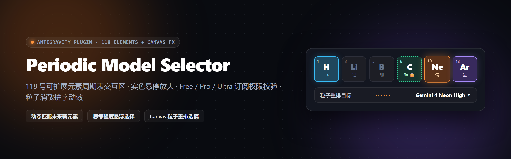
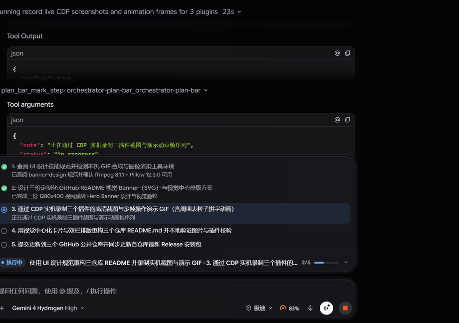
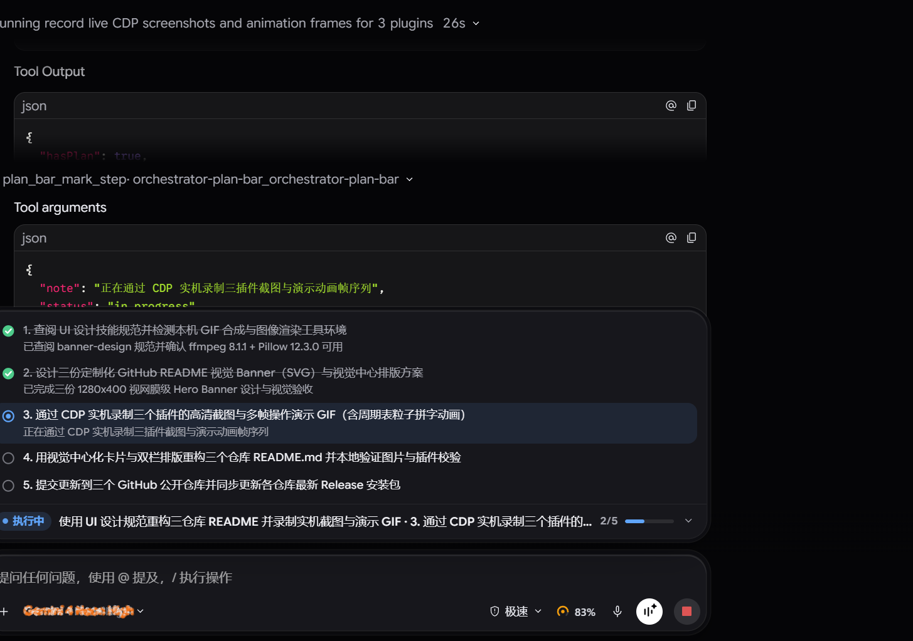

<div align="center">



<br /><br />

# Antigravity Periodic Model Selector

**可扩展的 118 号元素周期表模型选择器 · 实色悬停放大 · 三档订阅分级 · 粒子消散拼字选模**

[](https://github.com/trrrrrryg/antigravity-periodic-model-selector/releases)
[](#核心特性)
[](#实机演示)

[实机演示](#实机演示) · [界面一览](#界面一览) · [核心特性](#核心特性) · [快速安装](#快速安装)

---

### 实机演示



<sub>悬停激活元素（H / C / Ne / Ar）放大展示思考强度并实时校验订阅权限；点击选定后菜单先行收回、元素停留滞空并瞬间粒子化飞向左下角触发器，汇聚排列成新选中的模型名称。</sub>

</div>

<br />

## 界面一览

<table>
  <tr>
    <td align="center" width="34%">
      <br />
      <strong>① 顶部元素周期表 + 下方其余模型</strong><br />
      <sub>动态点亮 H / C / Ne / Ar，其余 114 个位置保持清晰灰阶；Orchestrator / Claude / GPT 等保留原样位于下方</sub>
    </td>
    <td align="center" width="33%">
      <br />
      <strong>② 实色放大与思考强度浮层</strong><br />
      <sub>悬停可用元素平滑放大 1.28× 并弹出实色思考强度菜单；直接点击元素格则使用默认思考强度</sub>
    </td>
    <td align="center" width="33%">
      <br />
      <strong>③ 粒子消散并重排为左下角文字</strong><br />
      <sub>选定后原菜单收起、卡片滞空爆裂为发光粒子，精准飞抵触发器并汇聚成新模型名称</sub>
    </td>
  </tr>
</table>

## 核心特性

- **118 号全元素动态识别（绝不写死）**：每次弹窗挂载时自动扫描 Antigravity React Context 中的 `modelSorts` 与 `groups`，将元素命名模型自动映射到 1～118 号标准周期表坐标；日后官方新增 `He`、`B`、`Si` 等新元素模型会自动点亮对应格子，也可通过 `window.__AGY_PTABLE.registerAlias(alias, symbol)` 扩展自定义别名。
- **三档订阅权限策略（Free / Pro / Ultra）**：
  - **Free 免费订阅**：Gemini 4 系列元素全部锁定并提示升级；
  - **Pro 订阅**：开放 `H`、`Ne`、`Ar`，锁定 `6 C (Carbon)` 并在悬停与点击时给出 Ultra 专属提示；
  - **Ultra 订阅**：全系元素无限制使用。（右侧 **Periodic Model Selector** 辅助面板支持一键模拟切换三档订阅预览效果）
- **100% 不透明实色卡片**：灰阶元素格、高光激活格与思考强度浮层全部采用实色混色，悬停放大时不透底、字迹清晰。
- **启动自动查新与一键更新**：每次启动自动查询 GitHub 最新 Release（支持 jsDelivr / Raw 备用源）；发现新版本时在周期表右上角展示无干扰提示按钮，点击后可选择**直接更新**（自动下载校验、原地替换并热重载）或**后续再更新**。

## 快速安装

1. 确保 Antigravity 启动参数包含 `--remote-debugging-port=9222`。
2. 从 [Releases](https://github.com/trrrrrryg/antigravity-periodic-model-selector/releases) 下载最新 `antigravity-periodic-model-selector-v1.1.0.zip` 并解压，或克隆本仓库：
   ```bash
   git clone https://github.com/trrrrrryg/antigravity-periodic-model-selector.git ~/.gemini/config/plugins/antigravity-periodic-model-selector
   agy plugin validate ~/.gemini/config/plugins/antigravity-periodic-model-selector
   agy plugin enable antigravity-periodic-model-selector
   ```
3. 打开对话框左下角模型选择器，即可体验元素周期表选模与粒子重排动效。

<details>
<summary><strong>仓库结构与技术说明</strong></summary>

- `plugin.json`：插件清单
- `assets/logo.svg`：元素周期表网格图标
- `sidecars/periodic_selector/main.mjs`：CDP 连接管理、热更新注入器及三档订阅预览辅助后台
- `sidecars/periodic_selector/inject.js`：118 号元素注册表、动态模型匹配、Shadow DOM 周期表 UI、独立 Portal 思考强度浮层及 Canvas 像素级粒子拼字引擎

</details>
